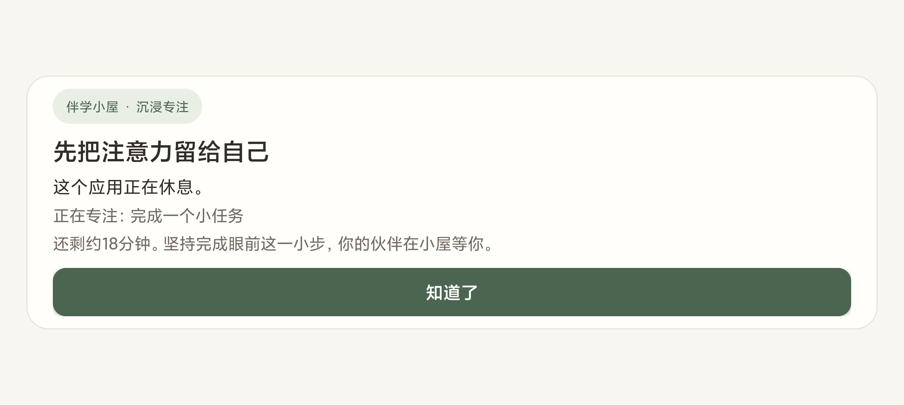

# 伴学小屋 · FocusNest

把学习计划、专注保护和宠物陪伴放在一起的 Flutter 应用。当前源码是 **0.2.7+11 体验版**：Android 有原生应用拦截和本机存储，网页使用虚拟数据，适合先体验页面与规则。

[体验包与历史发布](https://github.com/carlkleinnw/FocusNest/releases) · [版本记录](CHANGELOG.md) · [发布与回滚](docs/版本发布与回滚.md) · [协作规则](AGENTS.md)

本轮排查与交付方法已整理为[可复用技能](docs/可复用技能.md)，源码在 `.agents/skills/`；技能整理不改变已安装的 0.2.7+11 应用。

本仓库以私有方式保存项目进度。当前体验版标签为 `v0.2.7-demo`，最终 APK 在 Xiaomi 15 / Android 16、已开启「自启动 + 省电无限制」条件下通过本轮验收。0.2.6 保留为未通过最近任务核心验收的历史候选版。不得用普通进程回收后的恢复宣称可以抵抗系统真正强停。

## 当前功能

| 页面 | 核心功能 |
| --- | --- |
| 小屋 | 宠物在场景里活动，支持抚摸、玩球与触摸反馈 |
| 学习计划 | 创建和调整每日任务，选择任务开始专注 |
| 长期目标 / 目标详情 | 制定目标和阶段，将每日任务与目标关联 |
| 沉浸专注 | 至少 30 分钟计时，完整完成奖励喂食，提前结束需两轮确认 |
| 应用锁定 | 读取应用列表，选择专注期间允许使用的白名单 |
| 专注记录 | 查看完成、取消和学习进度记录 |
| 休息安排 | 提前安排休息日，暂停当天的饥饿结算 |
| 领养 | 宠物死亡后，完整完成一次至少 30 分钟的重启专注，再领养和命名 |
| 演示控制 | 网页模拟完成、日期推进与重置，方便体验规则 |

宠物在连续未完成专注的学习日逐渐饥饿、消瘦，7 个连续非休息日后死亡。完整完成一次专注会清零饥饿；互动和提前取消不会喂食。任务实际完成量独立记录，计时结束不会自动证明任务已完成。

初始计划和历史是样例。Android 使用真实时间，将计划、目标、宠物和记录保存在应用私有 SQLite 中；网页保存在内存，刷新会重置。

## Android 上体验

本机 0.2.7 APK 位于 `build/app/outputs/flutter-apk/app-release.apk`，已沿用原签名覆盖安装在 Xiaomi 15 上。[0.2.7 体验包](https://github.com/carlkleinnw/FocusNest/releases/tag/v0.2.7-demo)提供 APK 与校验清单。验收状态见[本轮记录](docs/validation/0.2.7-device-checks.json)；本节以下步骤描述 0.2.7。历史体验包可在发布页找到。

1. 首次打开可选择前往系统开启专注保护权限，或暂不启用。已经授权过的普通打开不再反复弹窗；专注中权限失效时会提示恢复。随时可从「更多 → 应用锁定」修改。
2. 在「应用锁定」查看独立白名单，点「添加应用」搜索或按类别筛选，再一次勾选需要的应用；其余非必要应用默认受限。旧版已有的明确白名单会保留，正在进行的专注仍按开始时的名单执行。
3. 点击「管理系统保护权限」，由本人在「辅助功能 → 已下载的应用」开启「伴学小屋专注保护」。
4. 通过「检查自启动与省电设置」进入伴学小屋应用信息。小米／澎湃 OS 需同时开启本应用「自启动」，并将省电策略设为「无限制」；其他手机按系统提供的后台选项设置。
5. 返回应用确认保护状态，选择任务，开始一次专注。
6. 打开白名单之外的应用，会显示与小屋风格一致的全屏提醒。点击「知道了」请求返回桌面，核实桌面已在前台后才撤掉提醒；再次打开仍会拦截。



默认拨号器、桌面与必要系统设置始终允许。覆盖安装后如果保护服务没有重新连接，需本人关闭再开启无障碍服务。详情见 [原生专注与计划联动](docs/原生专注与计划联动.md) 和 [拦截修复说明](docs/拦截修复与参考.md)。

原生保护使用无障碍窗口事件和专注期间的补充检查，仅读取根窗口所属应用，不读取页面文字、输入或截图，不上传应用名单。手机系统调度可能带来短暂延迟；返回桌面不等于杀掉第三方进程。此前小米 15 单卡上划触发强停的测试缺少「自启动」条件：本轮同包对照发现开启后变为普通系统回收，系统能重新绑定无障碍并恢复提醒。此结论有设备和设置条件，不保证零中断或所有品牌有效。真正强停/撤权仍需重新打开并本人恢复权限。[机制、开源源码与对照说明](docs/最近任务划除与后台设置.md)。

**验证范围：** 0.2.7 以最终 APK 的[本轮验证记录](docs/validation/0.2.7-device-checks.json)为准；0.2.6 的原始失败记录保留在[历史记录](docs/validation/0.2.6-device-checks.json)，不改写为成功。其他品牌、长期后台和耗电情况仍需验证。

## 网页 Demo

0.2.7 网页构建位于本机 `build/web`。[发布页](https://github.com/carlkleinnw/FocusNest/releases/tag/v0.2.7-demo)的 `FocusNest_Demo_0.2.7.zip` 包含源码与构建好的网页，解压后双击 `启动Demo.cmd`。需要本机已有 Python；启动器优先使用已有的 `E:/Conda/python.exe`，否则从系统路径查找 Python。

推荐先在小屋逗宠物，再创建计划和长期目标、开始专注，到演示控制模拟完成或推进日期，体验喂食、饥饿和重新领养。

网页中的外部应用拦截及悬浮只是演示。GitHub 的源码 ZIP 和普通克隆不含 `build/web`，需要按下面的开发步骤运行或构建。

## 开发与检查

已验证工具链：Flutter **3.41.9**、Dart **3.11.5**、JDK **21.0.9**（Java 编译目标为 17）；Android 体验包最低 API 24，目标 API 36。依赖由 `pubspec.lock` 固定，主要使用 Riverpod 3.3.2、Flame 1.38.2、GoRouter 17.5.0。当前提供 Android 和 Web 工程，iOS 原生保护尚未实现。

先准备 Flutter、Chrome；Android 开发另需 Android SDK 和 JDK。本机沿用 D 盘已有 SDK，源码与缓存位于 E 盘；安装前检查剩余空间，优先充足的非 C 盘。

```powershell
git clone https://github.com/carlkleinnw/FocusNest.git E:/FocusNest
cd E:/FocusNest
./scripts/Install-ReleasePolicy.ps1

# 可按本机环境修改缓存位置；先确保目录存在。
New-Item -ItemType Directory -Force E:/DeveloperCache/focus_pet/pub | Out-Null
$env:PUB_CACHE = 'E:/DeveloperCache/focus_pet/pub'
flutter pub get
flutter run -d chrome
```

私有仓库克隆需要已授权的 GitHub 登录。若目标目录已有项目，请直接在原目录更新，不要覆盖。

```powershell
flutter analyze
flutter test
./android/check-focus-gate.ps1 -JavaHome 'D:/Android/Android_studio/jbr'
flutter build web --release --no-web-resources-cdn
flutter build apk --release
```

本机覆盖安装还须沿用原有 Android 开发签名：构建前设置 `ANDROID_USER_HOME=E:/DeveloperCache/focus_pet/android`，并核对已安装包与新 APK 的签名证书；其他机器不能仅凭版本号认为可覆盖安装。此私有目录和签名文件不进入仓库或发布附件。

JDK 路径应按本机调整。构建好的网页也可以通过 `启动Demo.cmd` 体验。Android 构建当前使用本机开发签名，其他电脑重新构建的证书可能不同，不能保证覆盖现有 APK；不要为安装而直接清空用户数据。

`v0.2.3-demo` 的历史检查通过：Flutter 静态检查、20 项 Flutter 测试、23 项原生规则检查、Android/Web 构建及上述真机测试。本次发布另行完成 [12 项版本脚本与推送检查](docs/validation/0.2.3-demo.1-release-policy.json)，使用 Windows PowerShell 5.1 和独立本地仓库验证。未配置 GitHub CI。

## 架构与后续扩展

```text
lib/core       模型、业务规则、控制器、扩展契约
lib/data       Android 与网页适配器、快照序列化
lib/ui         可复用组件、导航与主题
lib/pages      每页一个核心功能
lib/pet        宠物绘制、场景和互动
android/       原生应用列表、保护服务、SQLite、平台通道
test/          规则、计划联动、页面与权限状态检查
scripts/       标签策略安装与版本推送
docs/          设计、能力边界、验证与回滚说明
```

界面读状态并发送操作，业务由控制器处理；Riverpod 注入时钟、存储、设备和智能服务。Flame 负责动画与反馈，业务计时不由游戏帧率驱动。背景图 `assets/images/room.png` 使用 ImageGen 生成，宠物通过 Dart 独立绘制。

大模型与 Agent 第一版保持禁用，只预留 `ContextPort`、`ActionPort`、`IntelligencePort`、`EventPort` 等契约。[设计约定](docs/设计约定.md) 和 [扩展接口](docs/扩展接口.md) 说明接入位置与动作边界。

## 每次更新打标签

每次完成一轮功能、修复、配置或文档更新，验证后提交，并创建**新的附注标签**。功能版本使用 `vX.Y.Z-demo`，同版本文档修订使用 `vX.Y.Z-demo.N`；已发布标签不移动、覆盖或删除。

```powershell
git add <本轮修改的文件>
git commit -m "说明本轮修改"
./scripts/Publish-Version.ps1 -Tag v0.2.3-demo.2 -Message "本轮文档更新及验证结果"
```

上面是下一次文档修订的示例。脚本检查版本和工作树，原子推送分支与标签；本机推送检查会拒绝缺少附注版本标签的分支更新。新克隆需要运行一次安装脚本，这项本地配置不会自动传播。

历史标签保存实际进度，包括有已知问题的早期 Demo。安全查看、另建历史目录和保留历史的撤销方法见 [版本发布与回滚](docs/版本发布与回滚.md)。**标签恢复代码，不恢复手机数据库、宠物状态或权限。**

仓库排除密钥、签名私钥、手机数据库、完整应用名单、个人截图、缓存、调试文件和构建产物；安装包及网页体验包通过 Release 附件保存。
